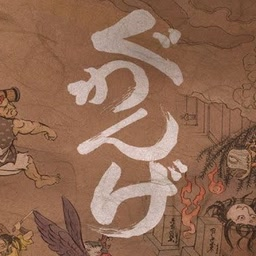

<h1 align=center>Guwange: Nintendo Switch port</h1>

<b>guwange-nx 1.0.1</b> · <a href="https://chanseyisthebest.github.io/guwange-nx-installer/">web installer</a> · <a href="https://github.com/ChanseyIsTheBest/guwange-nx/releases/tag/v1.0.1">release</a>

An unofficial native port of the Xbox Live Arcade version of **Guwange** (CAVE), with its Title Update #1, made by
static recompilation with [ReXGlue](https://github.com/rexglue/rexglue-sdk). No emulator. It is built on
[futari-nx](https://github.com/ChanseyIsTheBest/futari-nx), the Mushihimesama Futari port.

This repository contains no game files. You need your own copy of the game, dumped from your own console: its content
package (title `58410A78`, `Content/0000000000000000/58410A78/000D0000/92ED9E87CBCB7292EC7ACD321AA6704531D395A558`)
and its **Title Update #1** package (`TU_1C422JO_000000G000000.0000000000084`), or folders you extracted them into.

## Playing it on the Switch

1. Open the web installer: **https://chanseyisthebest.github.io/guwange-nx-installer/**
2. Give it the game and its title update (the two package files or their folders) and press **Create guwange-nx.zip**.
   Everything runs in your browser; your game files never leave your computer.
3. Extract `guwange-nx.zip` into `sdmc:/switch/`.
4. Start it with a game override (hold **R** while starting an installed title) or a forwarder.

To update, press **Create guwange-nx-update.zip** on the same page and extract it over your folder. Your
`guwange.toml`, saves and game files stay.

- A forwarder must be set to a **39-bit address space**. Album applet mode does not give the game enough memory.
- The first time you play, the game compiles its shaders as it meets them, so it can stutter for a moment in new
  places. Later sessions are smooth.

## Features

- Steady 60 fps on the console.
- Native renderer: reNut's Direct3D-level renderer on deko3d, the Switch GPU's own API.
- The arcade video chip's drawing runs as native Switch code.
- Low input lag: the game skips one frame to catch up if a picture misses its refresh.
- The title update is applied at start, as on the Xbox 360; the game's shaders are made from your copy by the installer.
- Two players (see below).

## Controls and settings

- Face buttons work by position, as on the Xbox 360 pad: B is the Xbox's A, A is B, Y is X, X is Y. ZR/ZL are RT/LT,
  R/L are RB/LB, + is Start, − is Back. Set `input_xbox_layout = false` in `guwange.toml` to use them by letter.
- Two players: every controller is its own player, in the order they connect (handheld mode counts as one). Single
  Joy-Cons are held sideways, one per player (SL and SR are the triggers). **L + R + ZR** opens the controller screen.
- `guwange.toml`, next to the NRO, holds your options: `input_xbox_layout`, `input_joycon_sideways`,
  `input_joycon_sideways_stick`, and each player's button map (`[input_p1]`, `[input_p2]`, e.g. `a = "B, ZR"`).
  Delete it to get the defaults back.

## Building

Needs Windows with LLVM clang 20 and the VS 2022 Build Tools (PC build); devkitA64, libnx and deko3d from
[devkitPro](https://devkitpro.org) (Switch); Python; and your own copy of the game (for the code generator and the
shaders). All steps are in [docs/building.md](docs/building.md).

futari-nx's notes, which this port shares (renderer, optimisations, how they were checked):
[docs/futari-notes.md](docs/futari-notes.md); research notes: [docs/research/](docs/research/).

## Credits and license

- **CAVE**: creators of Guwange.
- **ChanseyIsTheBest**: this port and futari-nx, the port it is built on.
- **[Tom Clay](https://github.com/rexglue/rexglue-sdk)**: the ReXGlue SDK, built on the work of the
  **[Xenia](https://xenia.jp)** team.
- **[StevensND](https://github.com/StevensND/nfsmw-nx)**: nfsmw-nx (the SDK's Switch layer, much of the method) and
  [nfsmw-nx-installer](https://github.com/StevensND/nfsmw-nx-installer), which this installer page is built on.
- **[nebadasSwifty](https://github.com/nebadasSwifty/masseffect-nx)**: masseffect-nx, whose native renderer
  futari-nx's renderer work grew from.
- **[hedge-dev](https://github.com/hedge-dev/XenosRecomp)**: XenosRecomp, the Xenos shader translator.
- **reNut and [masterspike52](https://github.com/masterspike52/reNut)**: reNut's Direct3D-level renderer (reused with
  its author's permission); banjo-nx (Banjo-Kazooie: Nuts & Bolts) for its adaptation, plume deko3d back end, shader
  passes and tools.
- **[plume](https://github.com/renderbag/plume)** (from UnleashedRecomp), **[deko3d](https://github.com/devkitPro/deko3d)**
  and **[uam](https://github.com/devkitPro/uam)** by fincs, with SwitchWakerHD's uam patches.
- **[devkitPro](https://devkitpro.org) and [switchbrew](https://github.com/switchbrew/libnx)**: devkitA64 and libnx.
- **[KhronosGroup](https://github.com/KhronosGroup/SPIRV-Cross)**: SPIRV-Cross.
- The sibling ports ([Sonic Adventure 2](https://github.com/ChanseyIsTheBest/sa2-nx), Banjo-Kazooie: Nuts & Bolts,
  Peggle 2, Peggle), which share their fixes; Peggle's installer (peggle1-nx-installer) for the title update steps in
  the browser.
- The other libraries listed in [THIRD_PARTY_NOTICES.md](THIRD_PARTY_NOTICES.md).

An unofficial, fan-made port. No affiliation with CAVE, Microsoft or Nintendo. "Guwange" is a trademark of CAVE
Interactive. This repository contains no assets or program code from the original game; you provide your own legally
obtained copy, and everything made from it (`assets/`, `app/generated/`, the shaders) is made on your own computer.
Running homebrew requires custom firmware, which violates Nintendo's ToS and can get a console banned.

GPL-3.0 (see [LICENSE](LICENSE)), like the ports it builds on; the SDK keeps its BSD-3-Clause license (see
[THIRD_PARTY_NOTICES.md](THIRD_PARTY_NOTICES.md)).
