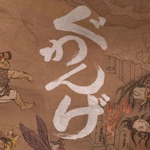

<div align=center>



</div>
<h1 align=center>Guwange — Nintendo Switch port</h1>

A native Nintendo Switch port of the Xbox Live Arcade version of **Guwange** (CAVE), with its Title Update #1.

It's not an emulator. The PowerPC code of the game's `default.xex` and of its four game cores (`module/*.dll`, one per
mode) is statically recompiled to C++ with [ReXGlue](https://github.com/rexglue/rexglue-sdk) and compiled for the
Switch, and the game's Direct3D calls are drawn directly on the Switch GPU's own API, deko3d, by
[reNut](https://github.com/masterspike52/reNut)'s Direct3D-level renderer. The port is built on
[futari-nx](https://github.com/ChanseyIsTheBest/futari-nx), the Mushihimesama Futari port.

> [!NOTE]
> You need your own copy of the game, dumped from your own console: its content package (title `58410A78`,
> `Content/0000000000000000/58410A78/000D0000/92ED9E87CBCB7292EC7ACD321AA6704531D395A558`) and its **Title Update #1**
> package (`TU_1C422JO_000000G000000.0000000000084`), or folders you extracted them into.

## How to install

1. Open the installer page: **https://chanseyisthebest.github.io/guwange-nx-installer/**
2. Choose the game and its title update (the two package files, or the folders you extracted them into), then press
   **Create guwange-nx.zip**. Everything runs in your browser and the game files never leave your computer: the page
   checks your copy, downloads the build and makes the shaders from your game's own files.
3. Extract the downloaded `guwange-nx.zip` into `sdmc:/switch/`.

Your `guwange-nx` folder should look like this:

```text
/switch/guwange-nx/
  guwange.nro
  LICENSES.txt
  guwange.toml              (your settings; written at the first start when it is missing)
  deko3d_glsl.bin           (the game's shaders, made from your copy)
  game_root/                (the game's files, with the title update's default.xexp and module/*.dllp)
```

The game adds `deko3d_shaders.bin` and `pipeline_list.bin` there as you play (the shaders compiled for the Switch
GPU, and the list of what it drew, so later sessions prepare it ahead).

Launch it with a game override (hold **R** while starting an installed title) or a forwarder. Album applet mode does
not give the game enough memory. If you use a forwarder, set it to a **39-bit address space**.

To build everything yourself instead, see [docs/building.md](docs/building.md).

> [!NOTE]
> **Updating:** open the installer page again and press **Create guwange-nx-update.zip**. It only holds the new
> `guwange.nro` and the shaders, so there is no need to copy the game again: extract it over your folder. Your
> `guwange.toml`, your saves and the game files stay.

> [!CAUTION]
> **The first time you play**, the game compiles its shaders for the Switch GPU as it meets them, so **IT CAN STUTTER
> for a moment** in new places. They are saved next to the NRO (`deko3d_shaders.bin`) and later sessions start
> smoothly.

## Controls

By default the face buttons work **by position, as on the Xbox 360 pad** the game was made for: the bottom button is
the Xbox's A, the right one is the Xbox's B, and so on.

<div align="center">

| Switch | Xbox 360 |
| --- | --- |
| B (bottom) | A |
| A (right) | B |
| Y (left) | X |
| X (top) | Y |
| ZR / ZL | RT / LT |
| R / L | RB / LB |
| + | Start |
| − | Back |
| Sticks / D-pad | Sticks / D-pad |

</div>

To use the buttons by letter instead (the Switch's A acts as A), set `input_xbox_layout = false` in `guwange.toml`.

**Two players:** every controller is its own player, in the order they connect. The console in handheld mode counts
as one, so handheld + a Pro Controller makes players 1 and 2. Single Joy-Cons are held sideways, one per player: the
face buttons, SL / SR (the triggers) and the stick are all turned for that grip. **L + R + ZR** opens the system's
controller screen to connect, reorder, or split a Joy-Con pair.

**Remapping:** each player has a button map in `guwange.toml` (`[input_p1]` and `[input_p2]`).

## Settings

`guwange.toml`, next to the NRO, holds only your options. Everything else is built into the NRO.

<div align="center">

| Setting | What it does |
| --- | --- |
| `input_xbox_layout` | Face buttons by position (`true`, default) or by letter (`false`) |
| `input_joycon_sideways` | Single Joy-Cons held sideways, one per player (`true`, default) |
| `input_joycon_sideways_stick` | With it, a single Joy-Con's stick turned for the sideways grip (`true`, default) |
| `[input_p1]`, `[input_p2]` | Each player's buttons: for every Xbox button, the Switch buttons that press it, e.g. `a = "B, ZR"` |

</div>

If you delete `guwange.toml`, the game writes the default one again at the next start.

## Performance

A steady 60 fps on the console, with the GPU at 460.8 MHz in handheld mode. The released NRO is built with link-time
optimisation and PGO from a console session of this version. Every optimisation has its own setting.

- **The game's own video chip, natively.** The Xbox 360 version draws the arcade picture in software: `default.xex`
  renders the three tile layers and the sprites of the arcade's video chip into a 16-bit frame buffer every frame.
  Those two routines run as native code written for the Switch (`app/src/cpu/guwange_native_video.cpp`), checked
  against the recompiled originals with zero differences, and the frame is uploaded to the GPU in a native 16-bit
  format instead of being converted.
- **The CPU work of the sibling ports**: futari-nx's code generator pipeline (sa2-nx's CPU rounds and banjo-nx's codegen
  round) on all five modules, native copies of the C library's `memcpy` and `memset`, a lock-free game clock.
- **Lower input lag**: the game reads the controllers as late in its frame as it safely can, and its 60 Hz follows the
  screen's own refresh. On the console a button press reaches the screen in about 28 ms on average.

## How it works

- **The game's code is translated, not emulated.** [ReXGlue](https://github.com/rexglue/rexglue-sdk) translates every
  function of `default.xex` and of the four game cores (all built for the same address and linked statically on the
  Switch) to C++, which is then compiled for the Switch. The cores are CAVE's own emulation of the arcade board's
  68000 program, so the arcade game runs exactly as on the Xbox 360. ReXGlue also gives the game what it expects from an Xbox
  360: its system, files, audio and controllers. The title update is applied at start, as on the Xbox 360.
- **A Direct3D-level renderer on deko3d.** The game's Direct3D calls are replaced by
  [reNut](https://github.com/masterspike52/reNut)'s renderer (as banjo-nx and futari-nx adapted it), which draws them
  with [plume](https://github.com/renderbag/plume) on [deko3d](https://github.com/devkitPro/deko3d), the Switch GPU's
  own API: no GPU command stream is written or parsed and no EDRAM is modelled.
- **Shaders made from your copy.** The installer page makes `deko3d_glsl.bin` in your browser from 78 of the game's 87
  shaders: the 68 stored in `default.xex` and the 10 of the sprite effects the game compiles at run time, which it reads
  from the game's resource archives with the game's own decompression. Renut's
  [XenosRecomp](https://github.com/hedge-dev/XenosRecomp) translates each one to HLSL, DXC compiles it to SPIR-V,
  [SPIRV-Cross](https://github.com/KhronosGroup/SPIRV-Cross) turns that into GLSL and banjo-nx's passes trim it,
  checked against the PC tools. The other 9 are in no game file (the game's runtime builds them), so the NRO carries
  those. The console compiles each one with [uam](https://github.com/devkitPro/uam) the first time it is used and keeps
  the result.

## Documentation

<div align="center">

| Document | What it explains |
| --- | --- |
| [docs/building.md](docs/building.md) | How to build the PC test build, the NRO and the shaders |
| [docs/futari-notes.md](docs/futari-notes.md) | futari-nx's notes, which this port shares: its renderer, optimisations and how they were checked |
| [docs/research/](docs/research/) | Research notes and comparisons with the sibling ports |

</div>

## Build

Windows, LLVM clang 20 and the VS 2022 Build Tools for the PC build; devkitA64, libnx and deko3d from
[devkitPro](https://devkitpro.org) for the Switch; Python; and your own copy of the game for the code generator and
the shaders. The whole process is in [docs/building.md](docs/building.md).

<div align="center">

| Folder | Contents |
| --- | --- |
| `app/` | The game: hooks, renderer, native functions, settings, CMake project (Futari's sources are still beside Guwange's, not built) |
| `sdk/` | ReXGlue SDK with the Horizon layer and the code generator changes |
| `shaders/` | XenosRecomp with the ports' changes and the shader package tools |
| `tools/` | Code generation steps, build and test scripts, analysis tools |
| `patches/` | Every change to third-party code (the SDK, FFmpeg, XenosRecomp) as diffs against upstream |
| `pgo/` | The PGO profile the released NRO was built with |
| `docs/` | Documentation |

</div>

## Credits

- **CAVE** — creators of Guwange. This is an unofficial, fan-made port with no affiliation.
- **ChanseyIsTheBest** — this port and futari-nx, the port it is built on.
- **[Tom Clay](https://github.com/rexglue/rexglue-sdk)** — the ReXGlue SDK, built on the work of the
  **[Xenia](https://xenia.jp)** team.
- **[StevensND](https://github.com/StevensND/nfsmw-nx)** — nfsmw-nx: the Switch layer of the SDK and much of the
  method; and [nfsmw-nx-installer](https://github.com/StevensND/nfsmw-nx-installer), the installer page this port's is
  built on.
- **[nebadasSwifty](https://github.com/nebadasSwifty/masseffect-nx)** — masseffect-nx: the native renderer futari-nx's
  renderer work grew from.
- **[hedge-dev](https://github.com/hedge-dev/XenosRecomp)** — XenosRecomp, the Xenos shader translator.
- **reNut and [masterspike52](https://github.com/masterspike52/reNut)** — reNut's Direct3D-level renderer, which the
  deko3d renderer is (reused with its author's permission); and Banjo-Kazooie: Nuts & Bolts' port (banjo-nx), whose
  adaptation of it, plume deko3d back end, shader passes and tools this port takes.
- **[plume](https://github.com/renderbag/plume)** (from UnleashedRecomp), **[deko3d](https://github.com/devkitPro/deko3d)**
  and **[uam](https://github.com/devkitPro/uam)** by fincs, with SwitchWakerHD's uam patches.
- **[devkitPro](https://devkitpro.org) and [switchbrew](https://github.com/switchbrew/libnx)** — devkitA64 and libnx.
- The sibling ports ([Sonic Adventure 2](https://github.com/ChanseyIsTheBest/sa2-nx), Banjo-Kazooie: Nuts & Bolts,
  Peggle 2, Peggle), which share their fixes with this one; Peggle's installer (peggle1-nx-installer) for the title
  update steps in the browser.
- **[KhronosGroup](https://github.com/KhronosGroup/SPIRV-Cross)** — SPIRV-Cross.
- The other libraries listed in [THIRD_PARTY_NOTICES.md](THIRD_PARTY_NOTICES.md).

## Legal

No affiliation with CAVE, Microsoft or Nintendo. "Guwange" is a trademark of CAVE Interactive. This repository
contains no assets or program code from the original game. Users must provide their own legally obtained copy, and
everything made from it (`assets/`, `app/generated/`, the shaders) is made on their own computer. Running homebrew
requires custom firmware, which violates Nintendo's ToS and can get a console banned — your call.

Source code is provided under the GPL-3.0 License (see [LICENSE](LICENSE)), like the ports it builds on. The SDK keeps
its BSD-3-Clause license (see [THIRD_PARTY_NOTICES.md](THIRD_PARTY_NOTICES.md)).
